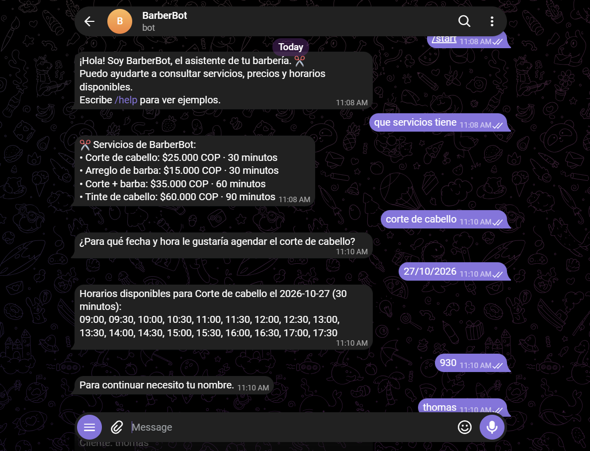

# Bitácora · BarberBot (Laboratorio 08–09)

Equipo: ______  Fecha: ______

> Completa cada evidencia con una captura o el texto real de lo que ocurrió. No incluyas la API key.

## 1. Solicitud completada en varios turnos
- Turno 1 (mensaje y plan en «Revisar historial del laboratorio»):
- Turno 2 (el plan conserva cliente y servicio):
- Resumen mostrado antes de confirmar:

## 2. Operación confirmada y fila en SQLite
- Código devuelto por la API:
- Consulta: `SELECT codigo, cliente, fecha, hora, estado FROM reservas;` → resultado:

## 3. Rechazo de cruce de intervalos
- Reserva A: corte_barba (60 min) 10:00 → código:
- Intento B: corte (30 min) 10:30 → HTTP 409, mensaje:
- Reserva contigua a las 11:00 → aceptada, código:

## 4. Disponibilidad antes y después
| Momento | Horas libres de «corte» |
|---|---|
| Antes de reservar | |
| Después de reservar | |
| Después de cancelar | |

## 5. Modificar (a libre y a ocupado) y cancelar
- Modificación a intervalo libre:
- Modificación a intervalo ocupado (datos anteriores conservados):
- Cancelación (estado = cancelada, intervalo liberado):

## 6. Descartar, reiniciar y dos sesiones
- Descartar: no se creó fila (consulta SQL):
- Reiniciar: el historial vuelve a empezar y las filas guardadas siguen:
- Ventana normal + ventana privada: conversaciones separadas; mismo intervalo → solo una aceptada:

## 7. Persistencia tras reiniciar la API
- Antes de reiniciar:
- Después de reiniciar:

## 8. Un error, su causa y la solución
- Error:
- Causa:
- Solución:

## 9. Explicación
Ver README, sección «Preguntas de la entrega», y redáctala con tus palabras.

## Clase 11 — Integración de BarberBot con Telegram

- Archivo añadido: bot_telegram.py.
- Dependencia añadida: python-telegram-bot>=22,<23.
- Recorrido del mensaje:
  Telegram -> recibir_texto() -> procesar_turno()
  -> consulta_llm.py -> Groq/FastAPI -> reply_text().
- Memoria: context.chat_data["historial"], separada por conversación.
- Evidencia de /start y /help:
- Evidencia de servicios y precios contrastados con FastAPI:
- Evidencia de consulta de disponibilidad:
- Evidencia de continuación de una consulta en varios mensajes:
- Problema de integración y solución: 