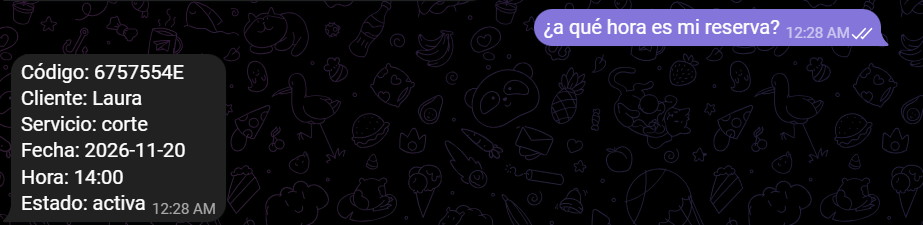
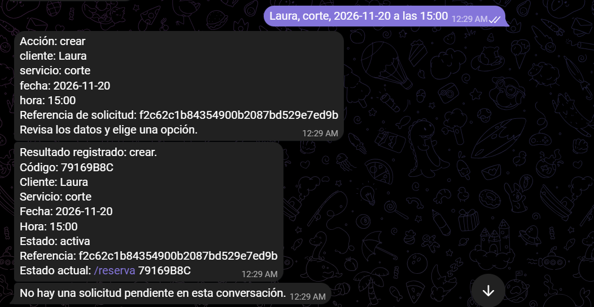
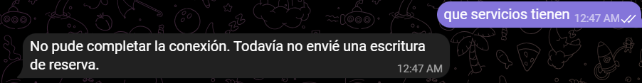
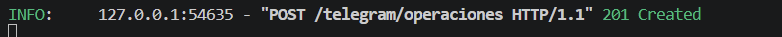
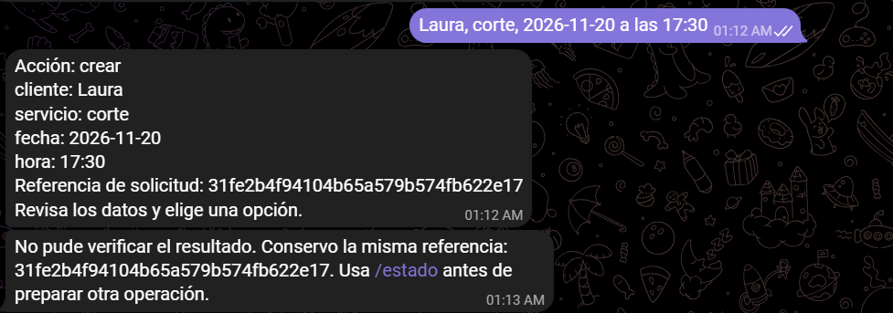
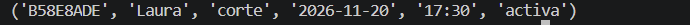
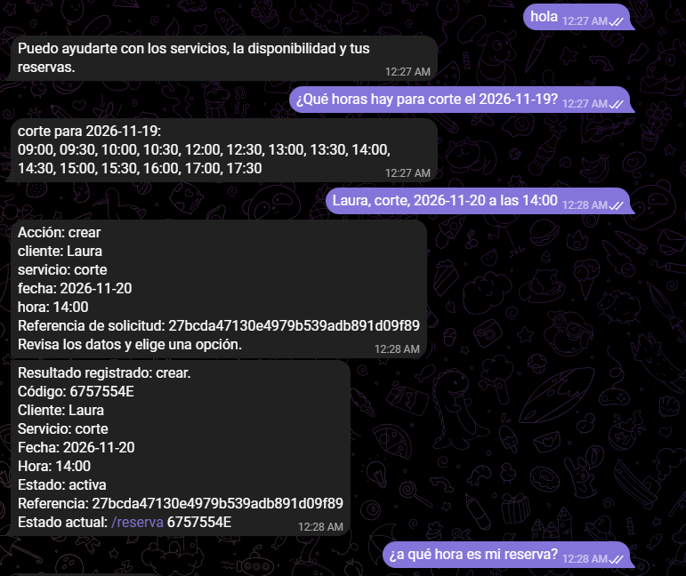

# Matriz de pruebas. Clase 13

**Equipo:** thomas garcia - juan jose marulanda - juan rodriguez - david hurtado  
**Repositorio y versión evaluada:** (https://github.com/Thogar126/Proyecto_Electiva)
**Fecha de ejecución:** _______11/11/2026_____________  
**Negocio y regla de disponibilidad:** BarberBot (barbería). Una sola agenda, lunes a sábado de 09:00 a 18:00, pasos de 30 minutos; dos reservas activas no pueden cruzar sus intervalos

## Preparación

Usen datos de práctica y dos cuentas privadas del mismo bot. Elijan una fecha futura en que atienda el negocio. Identifiquen las reservas aceptadas por su código y cada intento por su referencia de solicitud.

Las tablas contienen expectativas; los resultados obtenidos y el cumplimiento se completan al ejecutar. Escriban «No ejecutado» si no pudieron probar un caso. No conviertan una expectativa en un resultado sin evidencia.

Antes de cada prueba registren las condiciones previas: cuenta, fecha, servicio, disponibilidad y registros que deben existir. Un caso que deja una reserva puede afectar al siguiente; utilicen horarios independientes o restablezcan datos de práctica de forma controlada.

## Casos mínimos

| Caso | Grupo | Entrada y pasos | Resultado esperado |
|---|---|---|---|
| T01 | Normal | Consultar servicios. | Datos que coincidan con el catálogo de la API. |
| T02 | Normal | Preguntar por el precio de un servicio existente. | Valor correspondiente al negocio, sin datos inventados. |
| T03 | Normal | Consultar disponibilidad de un servicio en una fecha válida. | Horarios obtenidos del servicio de disponibilidad. |
| T04 | Normal | Consultar una reserva propia por su código. | Estado y datos actuales de esa reserva autorizada. |
| T05 | Normal | Continuar una consulta después de confirmar una operación. | El contexto contiene el código y el resultado real devuelto por la API. |
| T06 | Normal | Consultar un precio mientras existe una propuesta pendiente. | Se responde la consulta y se conserva intacta la propuesta vigente. |
| T07 | Incompleta | Preparar una reserva sin fecha en una conversación nueva. | Se pide el dato; no se envía una escritura. |
| T08 | Incompleta | Preparar una reserva sin hora. | Se solicita completar o seleccionar la hora antes de presentar la confirmación final. |
| T09 | Incompleta | Solicitar modificar una reserva sin identificarla. | Se pide el código o se permite elegir entre las reservas autorizadas. |
| T10 | Ambigua | Pedir «cambia esa reserva» cuando hay varias referencias posibles. | Se aclara cuál es la reserva antes de construir una modificación. |
| T11 | Contexto | Alternar mensajes de dos cuentas con solicitudes diferentes. | Cada plan utiliza únicamente los datos de su conversación. |
| T12 | Estado | Reiniciar el chat de Laura mientras Andrés tiene una propuesta pendiente. | Se limpia el estado normal de Laura; la propuesta de Andrés y las reservas confirmadas se conservan. |
| T13 | Estado y permisos | Utilizar desde otra cuenta un código de reserva ajeno. | No se revelan sus datos ni se permite modificarla o cancelarla. |
| T14 | Estado | Pulsar un botón del resumen anterior después de reemplazar la propuesta. | Se rechaza el identificador antiguo y la propuesta nueva permanece sin ejecutar. |
| T15 | Fuera del dominio | Preguntar por un asunto ajeno al negocio. | Orientación sobre el alcance del bot, sin efectos en las reservas. |
| T16 | Fuera del dominio | Solicitar tokens o claves de acceso. | No se entregan credenciales ni se consulta un listado de secretos. |
| T17 | Fuera del dominio | Pedir una tarea técnica sin relación con el servicio del negocio. | Se mantiene el alcance de atención y no se generan acciones de negocio por esa petición. |
| T18 | Operación | Crear una reserva, confirmar y repetir la pulsación. | Un solo registro aceptado para esa solicitud; el segundo evento no repite la escritura. |
| T19 | Operación | Modificar una reserva propia a un horario disponible y confirmar. | Se conserva el código del registro modificado y se comprueban sus nuevos datos en la API. |
| T20 | Operación | Cancelar una reserva propia y confirmar. | El servicio devuelve su estado cancelado y deja de contarla como ocupación. |
| T21 | Operación | Descartar una propuesta completa. | No se ejecuta la operación y la propuesta deja de estar disponible para confirmar. |
| T22 | Operación | Intentar confirmar intervalos que se cruzan desde dos cuentas. | Se acepta como máximo la ocupación compatible con la regla del negocio. |
| T23 | Error | Detener FastAPI durante una consulta de lectura. | Aviso de conexión y ausencia de un resultado de negocio inventado. |
| T24 | Situación límite | Simular que se pierde la respuesta después de enviar una escritura. | Se informa el resultado incierto, se conserva su referencia y se comprueba antes de reenviar. |
| T25 | Error | Modificar una reserva hacia un horario que la API rechaza. | Se informa el rechazo y la reserva original permanece sin cambios. |

T12 se prueba sin una escritura incierta pendiente. La espera obligatoria hasta verificar ese resultado se revisa en T24.

T22 puede probarse primero con dos chats intercalados. Si afirman haber comprobado concurrencia, indiquen además cómo enviaron escrituras HTTP que se superpusieran; el bot procesa actualizaciones secuencialmente.

Para T24, sigan la sección «Resultado incierto» del laboratorio y utilicen `simular_respuesta_perdida.py` con datos de práctica. Para T23 basta detener FastAPI durante una consulta de lectura y volver a iniciarla después.

Si el proyecto utiliza pedidos u otro proceso, adapten los casos de agenda a una restricción real, como cupo o disponibilidad de un recurso. Conserven confirmación, propiedad, persistencia y verificación de errores.

## Resultados del equipo

En «Condiciones» incluyan el estado previo; en «Obtenido», la respuesta y el efecto real. En «Evidencia» enlacen la captura o registro correspondiente. El efecto de una escritura se contrasta con la API o SQLite.

| Caso | Condiciones previas | Resultado obtenido | Cumple: Sí / No / No ejecutado | Evidencia |
|---|---|---|---|---|
| T01 | Por completar | Listó los 4 servicios con precio y duración. | Si | |
| T02 | Por completar | Mostró la lista; el corte figura en $25000. Sin datos inventados. | si |  |
| T03 | ya habia una cita separada | Listó horas libres del 2026-11-18, sin 10:00 ni 10:30. | si | |
| T04 | Por completar | /reserva 84C1EBFA mostró los datos y el estado activa. | si | Por adjuntar |
| T05 | Por completar | Tras confirmar 6757554E, «¿a qué hora es mi reserva?» respondió código, 14:00 y estado activa, sin pedir el código. | si |  |
| T06 | Por completar | Con propuesta pendiente respondió el precio; luego Confirmar creó la reserva 84C1EBFA. | si|   |
| T07 | Por completar | Pidio cliente, fecha, hora Sin resumen ni escritura. | si | |
| T08 | Por completar | Pidió «hora». Sin resumen ni escritura. | si |  |
| T09 | Por completar | Pidió «codigo, servicio, fecha, hora». | si | Por adjuntar |
| T10 | Por completar | Con 2 reservas, «Cambia esa reserva» pidió el código, sin elegir ninguna. | si | Por adjuntar |
| T11 | Por completar | Por ejecutar | No ejecutado | Por adjuntar |
| T12 | Por completar | Por ejecutar | No ejecutado | Por adjuntar |
| T13 | Por completar | Por ejecutar | No ejecutado | Por adjuntar |
| T14 | Por completar | Por ejecutar | No ejecutado | Por adjuntar |
| T15 | Por completar | Explicó su alcance. Sin efecto en reservas. | si |  |
| T16 | Por completar | Explicó su alcance. No entregó credenciales. | si|  |
| T17 | Por completar | Explicó su alcance. No generó el programa. | si | |
| T18 | Por completar | Tras el primer Confirmar creó 79169B8C. El segundo respondió «No hay una solicitud pendiente en esta conversación». | si |  |
| T19 | Por completar | Cambió 99C9B726 a las 14:00, mismo código, estado activa.	 | si | Por adjuntar |
| T20 | Por completar | Tras cancelar 99C9B726, las horas libres del 2026-11-19 incluyen 14:00. | si | |
| T21 | Por completar | Descartó la propuesta: «Las reservas registradas se conservan». | No ejecutado | Por adjuntar |
| T22 | Por completar | Por ejecutar | No ejecutado | Por adjuntar |
| T23 | Por completar | error de conexion| si |  |
| T24 | Por completar | Con simular_respuesta_perdida.py se ocultó al bot la respuesta tras guardar. El bot avisó «No pude verificar el resultado» y conservó la referencia. /estado recuperó el recibo (reserva B58E8ADE) y SQLite mostró una sola fila | si |     |
| T25 | Por completar | Rechazó el cambio a 11:30: «El nuevo intervalo está ocupado». La reserva seguía a las 14:00. | si | Por adjuntar |

## Registro de fallos y correcciones

Copien esta ficha por cada fallo encontrado:

### Caso y fallo observado

- **Caso:**
- **Resultado esperado y diferencia observada:**
- **Causa localizada en el proyecto:**
- **Corrección aplicada y archivo modificado:**
- **Repetición del caso y evidencia:**
- **Pruebas cercanas de regresión y resultado:**
- **Limitaciones pendientes:**
Caso y fallo observado: Error de "formato no esperado" al armar la reserva
Caso: Al intentar preparar una reserva completa (nos saltó este error en las pruebas T04, T06, T18 y T19).

Resultado esperado y diferencia observada: Esperábamos que el bot nos mostrara el resumen bonito con los botones de Confirmar y Descartar. En lugar de eso, nos tiraba el error «La respuesta no tiene el formato esperado».

Causa localizada en el proyecto: Nos dimos cuenta de que la función interpretar en bot_telegram.py exige que la accion venga en el primer nivel del JSON. Pero el modelo (openai/gpt-oss-120b) se inventó un formato anidado tipo {"plan": ..., "resultado": ...} porque se copió de la forma en que el bot guarda el historial. Entonces la validación fallaba diciendo «Acción inválida». (A veces el modelo ni siquiera devolvía un JSON).

Corrección aplicada y archivo modificado: En bot_telegram.py, ajustamos interpretar para forzar que use response_format JSON y le pusimos la temperature en 0. Por si acaso, le pusimos código para que desenvuelva plan si llega anidado. También modificamos el prompt en INSTRUCCIONES para exigirle sí o sí un objeto plano con las seis claves.

Repetición del caso y evidencia: Le escribimos «Laura, corte y barba, 2026-11-20 a las 11:00». Esta vez sí mostró el resumen bien y se confirmó (creó la reserva 84C1EBFA). Evidencia guardada en: evidencias/reservas_1.png.

Pruebas cercanas de regresión y resultado: Volvimos a correr T04, T06, T19 y T25 y todas pasaron sin problema.

Limitaciones pendientes: Como la salida del LLM no es 100% determinista, si algún día le da por inventarse un formato totalmente nuevo, el bot va a seguir tirando el aviso de error genérico.

Caso y fallo observado: El bot mostraba el catálogo en vez de pedir los datos
Caso: Prueba T07.

Resultado esperado y diferencia observada: Se suponía que tenía que pedir los datos que faltaban, pero después de hacer /reset, le mandamos «quiero un corte» y el man devolvió toda la lista de servicios.

Causa localizada en el proyecto: En el prompt de INSTRUCCIONES se nos olvidó quemarle cuáles eran los servicios válidos, y tampoco le explicamos la regla de que debe usar la acción crear siempre que la persona tenga intención de reservar (así falten datos).

Corrección aplicada y archivo modificado: Editamos bot_telegram.py. En la variable INSTRUCCIONES le pusimos claros los servicios válidos (corte, barba, corte_barba, tinte) y la regla estricta de usar crear aunque no estén completos los datos del cliente.

Repetición del caso y evidencia: Le mandamos «quiero un corte» y ya respondió bien: «Necesito: cliente, fecha, hora». Evidencia: evidencias/reservas_1.png.

Pruebas cercanas de regresión y resultado: Las pruebas T08, T09 y T10 pasaron de una, pidiendo los datos faltantes como debía ser.

Limitaciones pendientes: Igual quedamos dependiendo de la interpretación que el modelo haga de lo que escriba el usuario.

Caso y fallo observado: El bot nos volvía a pedir un código que ya tenía
Caso: Prueba T05.

Resultado esperado y diferencia observada: Esperábamos que el bot usara el código de la reserva que acabábamos de confirmar para seguir el flujo. Pero en el primer intento el bot nos salió con «Necesito: codigo».

Causa localizada en el proyecto: Vimos que el bot solo conserva el código en la memoria si el modelo lo vuelve a mandar en el campo codigo del JSON; en ese intento en específico, el LLM lo mandó vacío y se perdió el contexto.

Corrección aplicada y archivo modificado: Le agregamos una instrucción para que el modelo priorice no perder el código de «mi reserva» en el contexto del chat.

Repetición del caso y evidencia: En el segundo intento, con la reserva 6757554E recién hecha, ya respondió con el código, la hora 14:00 y el estado activa sin tener que volver a pedir el código. Evidencias: evidencias/bloqueA_1.png y evidencias/bloqueA_2.png.

Pruebas cercanas de regresión y resultado: Verificamos T04 y T06 y siguieron funcionando bien.

Limitaciones pendientes: El resultado puede variar porque depende de qué tan bien maneje el modelo la ventana de contexto; no lo repetimos más veces.
## Casos adicionales recomendados
Vencimiento de una propuesta: Ver qué pasa si el bot deja la propuesta en pantalla y el usuario se demora horas en darle "Confirmar" o "Descartar". Hay que ver si la hora se libera bien.

Recibo recuperado después de reiniciar el proceso: Validar que si cortamos el chat a la mitad o tiramos un /reset, el cliente igual pueda sacar el comprobante de su reserva vieja usando el comando /estado.

Reserva "robada" mientras se revisaba un resumen (Condición de carrera): Qué pasa si un cliente tiene el resumen ahí y se queda pensando, y justo en ese segundo otro cliente bloquea esa misma hora. Debería rebotarle al primero cuando por fin intente confirmar.

Mismo identificador con datos diferentes: Intentar meterle un código de reserva válido, pero mandando el nombre de otro cliente a ver si la validación de la API es lo bastante fuerte para bloquearlo.

Confirmación válida después de corregir un botón antiguo: Scrollear súper arriba en el chat y darle click a un botón de "Confirmar" viejísimo para ver cómo reacciona el bot y asegurarnos de que no dañe la reserva actual.

Vencimiento de una propuesta; recibo recuperado después de reiniciar el proceso; reserva cambiada mientras se revisaba un resumen; mismo identificador con datos diferentes; confirmación válida después de corregir un botón antiguo.

La matriz final se incorpora al repositorio y se relaciona con la bitácora. Cada integrante debe poder explicar una prueba, el componente que valida su resultado y la evidencia utilizada.
